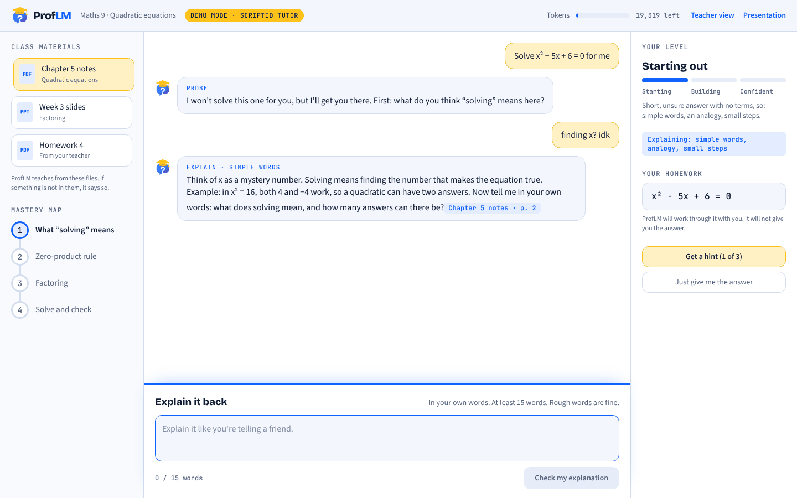
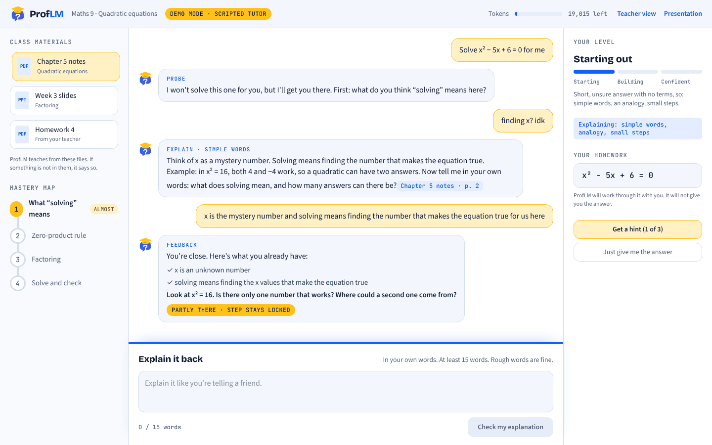
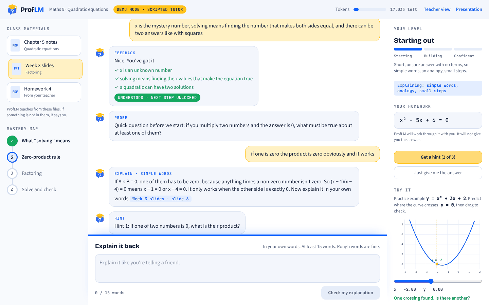
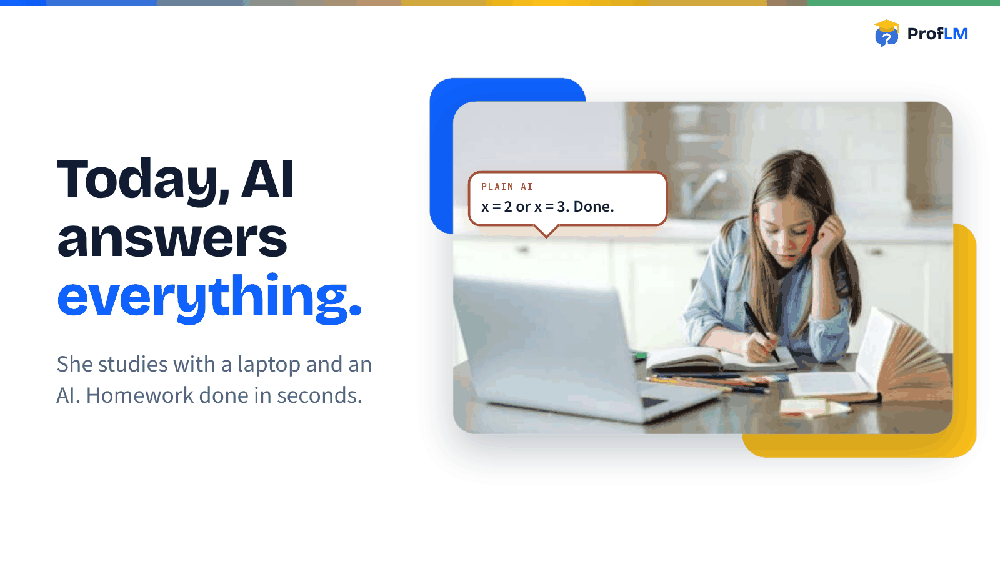
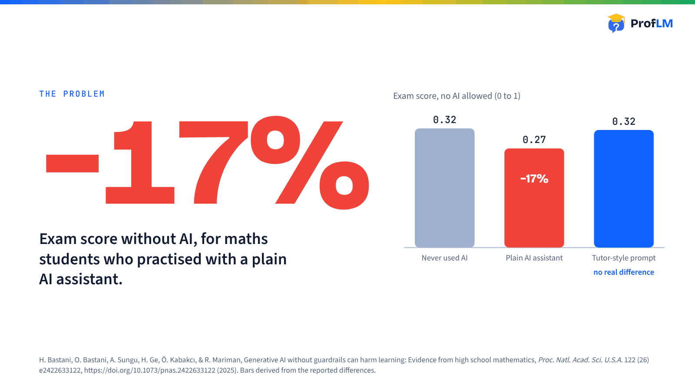
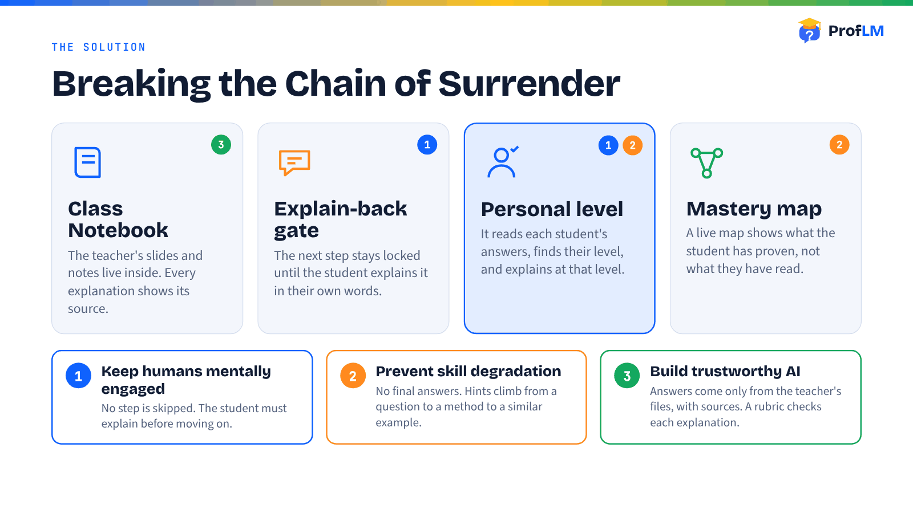
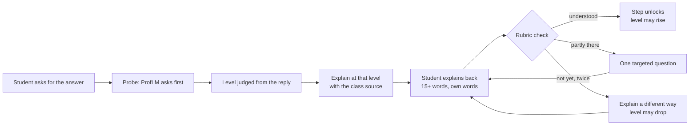
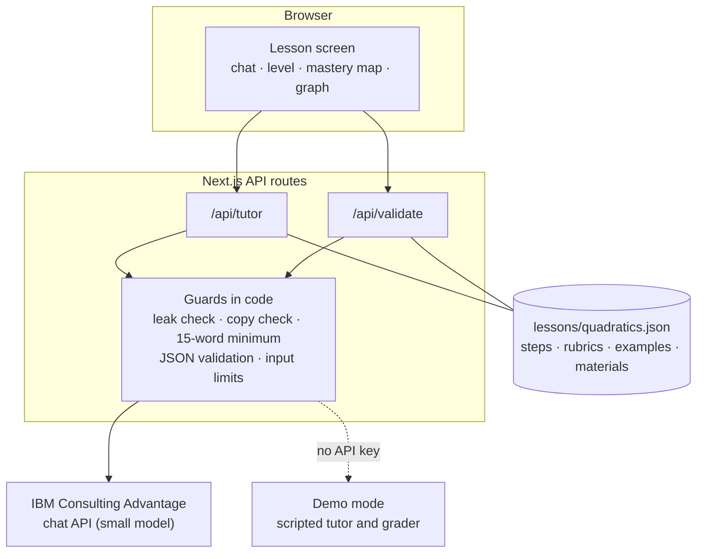

<p align="center">
  
</p>

<h3 align="center">The AI coach that asks before it answers.</h3>

<p align="center">
  A tutor for school students that teaches from the <b>teacher's own materials</b>, explains at each <b>student's level</b>, and makes the student <b>explain it back</b> before the next step unlocks.<br>
  It never gives the answer to the student's own homework.
</p>

<p align="center">
  <a href="#see-it">See it</a> ·
  <a href="#how-a-lesson-works">How it works</a> ·
  <a href="#the-three-dimensions-of-the-challenge">Challenge dimensions</a> ·
  <a href="#try-it-in-two-minutes">Try it</a> ·
  <a href="#what-is-real-and-what-is-not">Honest status</a> ·
  <a href="#for-reviewers-the-evidence-in-one-place">For reviewers</a>
</p>

---

## The 30-second version

| | |
|---|---|
| **Problem** | Students use AI to get answers, and the thinking that makes learning stick gets skipped. In a controlled study of about 1,000 high-school maths students, those who practised with a plain AI assistant scored **17% lower on the exam without AI** than students who never used it. They did not notice. |
| **Why hints are not enough** | A tutor-style prompt removed the harm, but produced **no learning gain** either. |
| **Our idea** | Make the student **produce** the understanding. ProfLM asks first, explains at the student's level, then requires an explain-back in their own words. A rubric decides whether the next step unlocks. |
| **Who it is for** | Students in grades 8 to 12 on school laptops, and the teacher who uploads the class materials. |
| **What you can run today** | A working lesson (quadratic equations): probe, level, explanation with a source, explain-back, rubric check, step lock, hint ladder, mastery map and an interactive graph. It runs with **no API key** (scripted demo mode) or **live** on IBM Consulting Advantage. |
| **What we have not proven** | Whether explain-back improves exam results. That is our hypothesis, and the pilot plan is below. |

> **Slogan:** AI as the coach. Not the autopilot.

## See it

<p align="center">
  
</p>

*The student answered "finding x? idk". ProfLM sets the level **Starting out**, shows why, and explains with simple words and an analogy. The class file it drew on lights up and the source tag appears under the explanation.*

<table>
  <tr>
    <td width="50%"></td>
    <td width="50%"></td>
  </tr>
  <tr>
    <td><b>Check, don't tell.</b> Two ideas right, one missing: the step stays locked and ProfLM asks one question instead of giving the missing part.</td>
    <td><b>Proof of understanding, not of reading.</b> The mastery map fills in as steps are explained. A practice graph lets the student predict and check. Hints climb from a question to a method to a similar example.</td>
  </tr>
</table>

**The 3-minute pitch deck** is part of this repo: run the app and open [`/pitch`](public/pitch.html), or open the self-contained file [`presentation/proflm-pitch.html`](presentation/proflm-pitch.html) in a browser (→ next slide, F fullscreen, R replays the demo). The talk track is in [`docs/PITCH.md`](docs/PITCH.md).

<table>
  <tr>
    <td width="33%"></td>
    <td width="33%"></td>
    <td width="33%"></td>
  </tr>
</table>

## How a lesson works



1. **Probe.** The tutor asks one question to find out what the student already thinks.
2. **Explain at their level.** The reply sets a level. The explanation changes with it.
3. **Explain back.** At least 15 words, in the student's own words. Text copied from the AI is detected and rejected.
4. **Check.** A rubric written for the step decides: understood, partly there, or missing. Only "understood" unlocks the next step.
5. **No final answers.** Hints climb in three levels. "Just give me the answer" gets a friendly redirect and **does not call the model**.

### Personalisation: three levels

The level comes from the student's first answer and then moves with how they actually do. It is shown on screen with a one-line reason, so students (and teachers) can see why the tutor explains the way it does.

| Level | Signal | What changes |
|---|---|---|
| **1 · Starting out** | short, unsure, no terms | simple words, an analogy, a very small step |
| **2 · Building** | partly right, some terms | precise terms with a short gloss, brief hints |
| **3 · Confident** | correct, uses the terms | concise and precise, no analogy, a challenge to try |

A correct explanation on the first try, with no hints, raises the level. Two failed tries lower it and trigger an explanation from a different angle.

## The three dimensions of the challenge

The brief asks for solutions that explore one or more of three dimensions. ProfLM works on all three.

| Dimension | What ProfLM does | Where to look |
|---|---|---|
| **1. Keep humans mentally engaged** | A question comes before every answer. The next step stays locked until the student explains it in their own words. Minimum 15 words. Copy-paste from the AI is rejected. | [`components/TeachBackPanel.tsx`](components/TeachBackPanel.tsx), [`app/api/validate/route.ts`](app/api/validate/route.ts), [`lib/guards.ts`](lib/guards.ts) |
| **2. Prevent skill degradation** | No final answers to the student's own homework. A three-level hint ladder. A mastery map shows what has been **proven**, not what has been read. The level adapts so the student is always working at the edge of what they can do. | [`lib/prompts.ts`](lib/prompts.ts), [`lib/levels.ts`](lib/levels.ts), [`components/MasteryMap.tsx`](components/MasteryMap.tsx) |
| **3. Build trustworthy AI** | Teaches from the teacher's files and shows which one. Says "ask your teacher" instead of guessing. A rubric check on every explanation. An answer-leak guard that inspects every field the student can see. The grader treats the student's text as data, not instructions. | [`lessons/quadratics.json`](lessons/quadratics.json), [`lib/guards.ts`](lib/guards.ts), [`lib/prompts.ts`](lib/prompts.ts) |

## Why this is different

| | Plain chat assistant | Tutor-style prompt | Summaries, quizzes, audio from your files | **ProfLM** |
|---|---|---|---|---|
| Answers from the class's own materials | no | no | yes | **yes, with the source shown** |
| Withholds the final answer | no | mostly (prompt only) | n/a | **yes, enforced in code** |
| Student must produce the explanation | no | no | no | **yes, locked step** |
| Checks the explanation against a rubric | no | no | no | **yes** |
| Adapts explanations per student | no | rarely | no | **yes, visible level** |
| Evidence it matters | −17% exam score in the study | no harm, no gain in the study | — | hypothesis, to be piloted |

## Try it in two minutes

```bash
git clone https://github.com/Ioane-M/IBM---Hackathon-.git
cd IBM---Hackathon-
npm install
cp .env.example .env.local     # leave ICA_API_KEY empty for demo mode
npm run dev                    # http://localhost:3000
```

Then try this: type `Solve x² − 5x + 6 = 0 for me`, answer the question with `finding x? idk`, explain back with one idea only, and watch the step stay locked. Click **Just give me the answer** at any point.

| Page | What it is |
|---|---|
| `/` | The lesson |
| `/teacher` | Teacher view (**mock data**, class-level numbers only) |
| `/pitch` | The presentation |
| `/api/health` | `{"mode":"demo"}` or `{"mode":"live"}` |

**Demo mode vs live mode.** With no key the tutor and grader are scripted, so the app always works and the header shows a yellow **Demo mode** badge. With a key the same screens run on IBM Consulting Advantage and the badge turns green.

```bash
# .env.local
ICA_API_KEY=...        # ICA UI > Settings > API Keys > ICA APIs
ICA_MODEL=...          # run `npm run ica-check` to list the models your key can use
ICA_COLLECTION_ID=     # optional: a document collection with the teacher's files
```

The key is read only on the server. The browser never calls ICA.

**Deploy on Vercel.** Import the repo, keep the defaults, and add `ICA_API_KEY` and `ICA_MODEL` under *Settings → Environment Variables*. With no variables the site runs in demo mode.

### Tests

| Command | What it checks | Needs a key |
|---|---|---|
| `npm run check` | 20 offline checks: answer-leak guard, copy detection, JSON parsing, level rules, grader, scripted tutor never leaks the homework answer | no |
| `npm run check:api` | 17 end-to-end checks against a running server: probe first, redirect without a model call, hint ladder, step lock, copy and short-answer rejection, instructions hidden in an answer do not unlock | no (works in both modes) |
| `npm run ica-check` | Lists your ICA models and tests one chat call and JSON compliance | yes |
| `npm run build` | Type-checks and builds | no |

## Architecture



- **Two small model calls per turn at most:** one for the tutor, one for the grader. The grader also writes the follow-up question, so a failed attempt costs one call, not two. A small model is enough because every call is short and focused.
- **Rules live in code, not only in the prompt.** The model cannot unlock a step. Only the server's grading result can, and a grading failure never unlocks by default.
- **Fails safe.** Bad JSON is retried once and then replaced by a safe message. A leaked answer is retried once and then replaced by a guiding question. Calls time out after 25 seconds.
- Full detail: [`docs/ARCHITECTURE.md`](docs/ARCHITECTURE.md).

## Responsible AI

| Concern | What we did |
|---|---|
| **Cognitive offloading** | Question first. Locked steps. Explain-back is required. |
| **Skill loss** | No final answers. Hint ladder. Level adapts to the student. |
| **Hallucinated facts and sources** | Teaches only from the lesson file. Outside it, the tutor says "ask your teacher". Source tag on each explanation. |
| **Transparency** | The level and the reason for it are visible. The mode (demo or live) is visible. Token use is visible. |
| **Student text as an attack surface** | Student text is fenced and treated as data. A test checks that an instruction hidden inside an answer does not unlock a step. |
| **Privacy** | Answers stay in the browser. The teacher view shows class-level numbers only. The API key never reaches the browser. |
| **Resource use** | Small model, short outputs, one step per call, a token meter. The "give me the answer" path makes no model call. |
| **Fairness** | Every student gets the same coaching. The level comes from what a student shows, not from who they are. |
| **Honesty about limits** | See the next section. |

## What is real and what is not

| Part | Status |
|---|---|
| Probe, level, explain, explain-back, rubric check, step lock, hint ladder | **Works** in demo mode and live mode |
| Mastery map, materials shelf, interactive graph, token meter | **Works** |
| Copy detection, 15-word minimum, answer-leak guard, grader fencing | **Works**, covered by `npm run check` and `npm run check:api` |
| Live tutoring on IBM Consulting Advantage | **Wired, needs your key.** Verify with `npm run ica-check` |
| Demo mode | **Scripted.** Keyword-based grading, example lesson only |
| Material titles and page references ("Chapter 5 notes · p. 2") | **Placeholders** in the lesson file, not real documents yet |
| Teacher view | **Mock data** |
| Progress storage | **Browser only.** A determined student could tamper with it. Next step: server-side storage |
| Does explain-back improve exam results? | **Not tested.** It is our hypothesis |

## Pilot plan (how we would find out)

1. One class, one topic, two groups: ProfLM and a plain assistant.
2. A **quiz without AI** before and after. This is the metric that mattered in the study.
3. Also track: first-try pass rate, share of "what is the answer?" messages, and tokens per student.
4. Teacher review of the lesson file before use.

## Roadmap

- Real class materials through ICA document collections (the upload script is a stub).
- Server-side progress and class analytics, with consent and access controls.
- More subjects and a lesson authoring tool for teachers.
- Accessibility and more languages.

## For reviewers: the evidence in one place

| Criterion | Evidence |
|---|---|
| **Use case innovation** | Problem rooted in the challenge theme (above). New combination: class-material grounding, explain-back gate and a visible per-student level. Defined user and a pilot path. |
| **Technical solution design** | Architecture diagram above and [`docs/ARCHITECTURE.md`](docs/ARCHITECTURE.md). Model used with purpose: small model, two short calls. Working prototype: `npm run dev`. Rules enforced in code: [`lib/guards.ts`](lib/guards.ts), [`app/api/`](app/api). 37 automated checks. |
| **Responsible AI factor** | Table above. Engagement, transparency, safeguards against unsupported claims, privacy and resource use are each implemented and testable. |
| **Pitch authenticity and creativity** | [`presentation/`](presentation), [`docs/PITCH.md`](docs/PITCH.md). Honest status table above, including what is scripted and what is untested. |

## Repository tour

```
app/page.tsx                 the lesson screen: state and flow
app/teacher/page.tsx         teacher view (mock data)
app/api/tutor/route.ts       tutor call, guards, demo-mode switch
app/api/validate/route.ts    grader call, guards, step unlock
app/api/health/route.ts      reports demo or live
components/                  Logo, TutorPanel, TeachBackPanel, MasteryMap, LevelCard,
                             MaterialsShelf, ParabolaViz, TokenMeter, SourcesChip
lib/ica.ts                   ICA client (timeouts, clear errors)
lib/prompts.ts               tutor and grader prompts
lib/guards.ts                word count, copy detection, leak guard, JSON parsing
lib/levels.ts                level names, styles and adjustment rules
lib/mock.ts                  demo-mode tutor and grader
lessons/quadratics.json      the lesson: steps, rubrics, examples, materials
public/pitch.html            the deck, served at /pitch
presentation/                the deck as one self-contained file
docs/                        architecture, talk track, change log, screenshots
scripts/                     check-guards, check-api, ica-check, ica-upload (stub)
```

## Documents

- [`docs/ARCHITECTURE.md`](docs/ARCHITECTURE.md): data flow, the model contract, guards and failure handling
- [`docs/PITCH.md`](docs/PITCH.md): what to say and show in three minutes
- [`docs/CHANGELOG.md`](docs/CHANGELOG.md): what we fixed after reviewing the first version
- [`DEMO.md`](DEMO.md): a 90-second walkthrough of the app

## References

- H. Bastani, O. Bastani, A. Sungu, H. Ge, Ö. Kabakcı, & R. Mariman, *Generative AI without guardrails can harm learning: Evidence from high school mathematics*, Proc. Natl. Acad. Sci. U.S.A. 122 (26) e2422633122 (2025). https://doi.org/10.1073/pnas.2422633122. The bar heights in our slides are derived from the reported differences.
- IBM Consulting Advantage developer APIs (chat completions, files, document collections).

Built for the **Responsible AI Hackathon**: *Designing AI that makes us smarter, not more dependent.*
